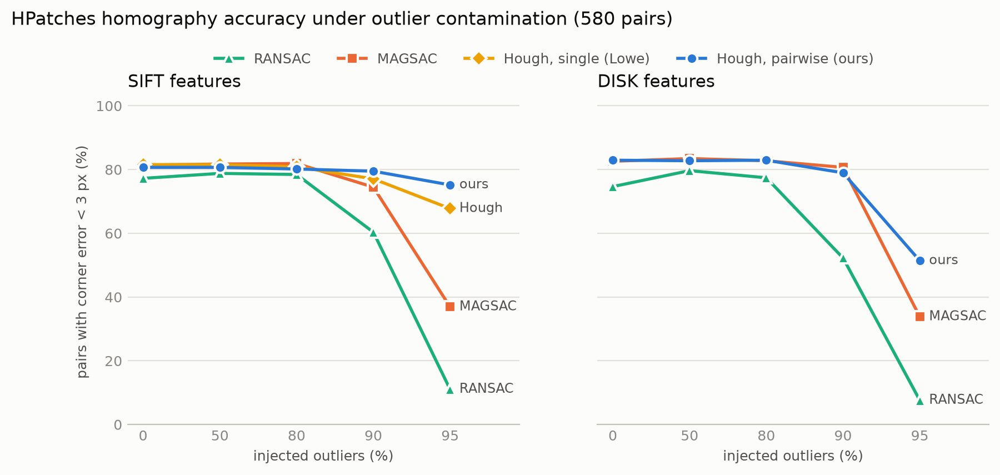
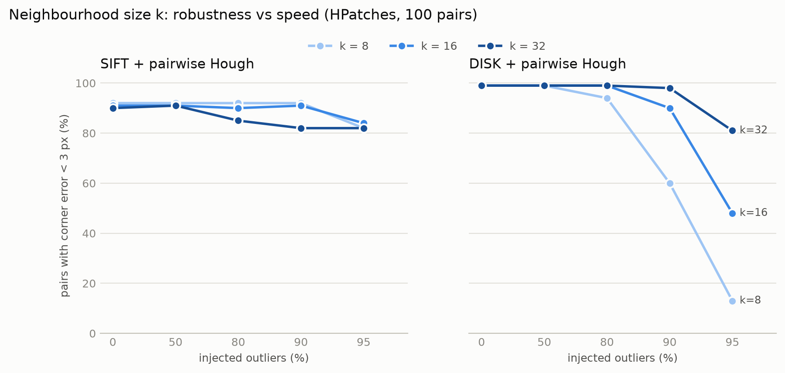
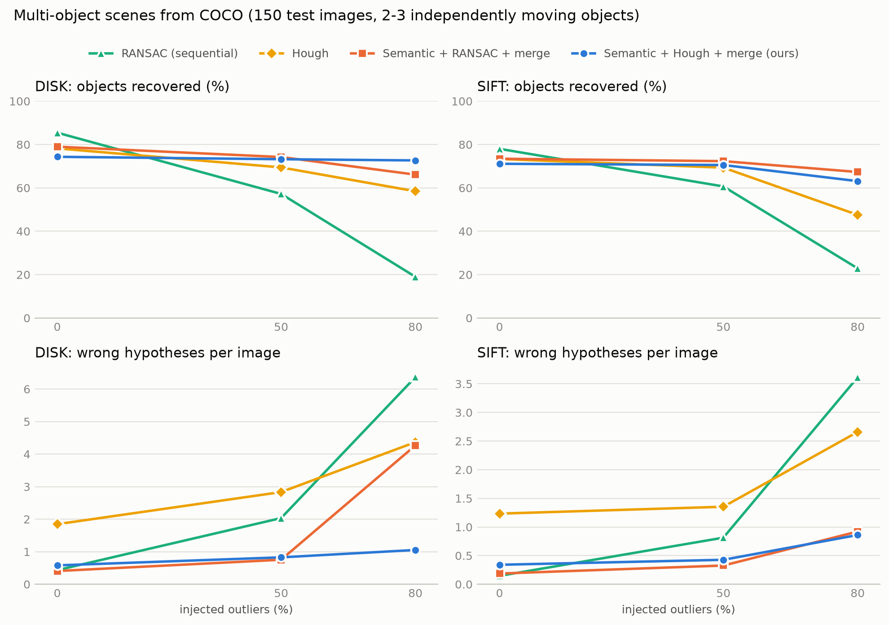
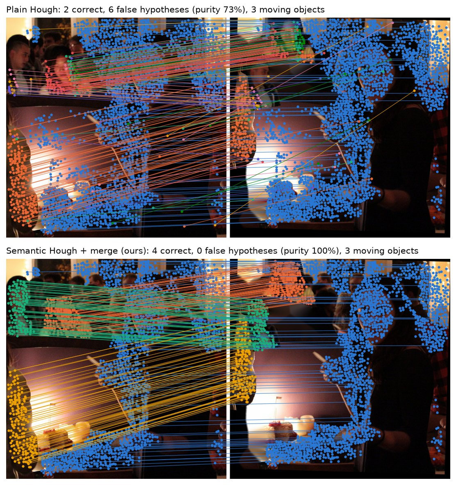
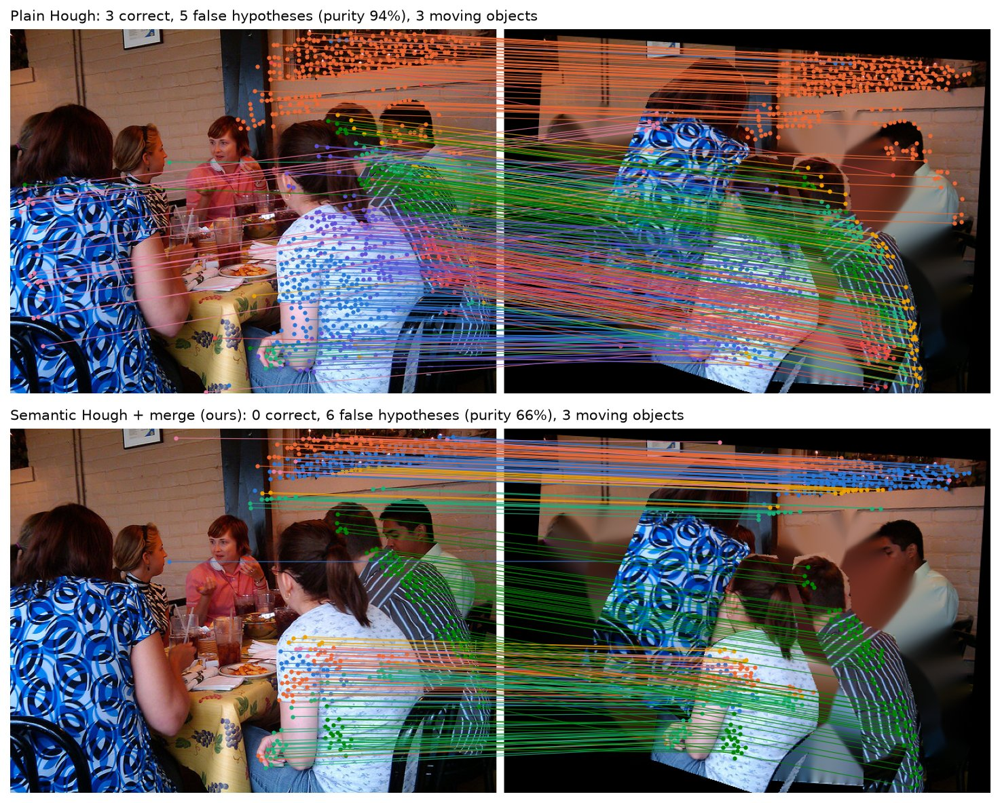

# Hough-SIFT

**Hough pose clustering for learned local features, with semantic-gated voting**

Course project for CSL7360: Computer Vision at IIT Jodhpur.

| Member | Roll no. |
|---|---|
| Rahul Kumar Bhikundia | M26CSA006 |
| Suggu Chandu | M26CSA017 |
| Navneet Singh | M26CSA004 |

📄 **Report:** [`report/main.pdf`](report/main.pdf) (NeurIPS 2025 format, 11 pages)

---

## Overview

- Classical **Hough pose clustering** (Lowe, 2004) is a deterministic, outlier-robust alternative to RANSAC, but it needs every keypoint to carry a **scale and orientation**. Modern learned detectors such as **DISK** and SuperPoint don't provide either.
- We make Hough verification work with learned features through **pairwise similarity voting**: two matches are enough to determine scale and rotation.
- Naive pairwise voting **collapses under heavy outliers**. We diagnosed why and fixed it with a **scale prior** and a **mutual-spatial-neighbour** rule.
- Result: **on par with MAGSAC++ up to 90% outliers**, and far ahead at **95% outliers** (75.2% vs 36.9% with SIFT, 51.4% vs 33.8% with DISK).
- For **multi-object scenes**, we add **semantic gating** with Mask R-CNN instance masks. Combined with Hough voting and duplicate merging, object recall stays at **≈73–74% from 0% to 80% outliers**, while sequential RANSAC falls from 85% to 19%.
- We also report **where the method loses**: on clean multi-object scenes, plain RANSAC is still best. The variants that failed are described too.

---

## 1. The problem

Matching local features between two images always produces a mix of correct and wrong correspondences. **Geometric verification** keeps only the matches consistent with one physical motion, usually a homography.

The standard tool is **RANSAC**: sample 4 matches, fit a homography, count the agreeing matches, repeat. Its weak point is that a 4-match sample is outlier-free with probability (1−ε)⁴. At ε = 90% outliers that's **1 in 10,000**, so RANSAC needs huge numbers of iterations in exactly the hard cases.

**Lowe's Hough voting** works differently. Every match *votes* for a pose (scale, rotation, position). Correct matches agree and form a peak in pose space, while wrong matches scatter their votes thinly. It is deterministic, uses each match once, and degrades gracefully.

Two gaps motivated this project:

1. **Learned features can't vote.** A SIFT match votes on its own because each SIFT keypoint has a scale and an orientation. DISK and SuperPoint output only an (x, y) position, so learned-feature pipelines fall back to RANSAC.
2. **Clutter creates false clusters.** In scenes with several objects, any two matches may vote together, so votes that span two different objects produce meaningless peaks.

---

## 2. Method

```
Image pair ─► Features + matching ─► Pairwise similarity votes ─► Hough accumulator ─► Least-squares refinement ─► H + inliers
              (DISK / SIFT,          (scale prior,                (16-bin soft voting,   (affine → homography)
               mutual NN + ratio)     mutual neighbours)           4-D, 5-D if gated)
                                                                         ▲
                                       Semantic gate (Mask R-CNN) ───────┘
                                       R1 class · R2 same instance · R3 instance as Hough dimension
```

### 2.1 Pairwise similarity voting

Two matches *i* and *j* form a segment **u** = p_j − p_i in image 1 and **v** = q_j − q_i in image 2. Comparing the two segments gives a full similarity pose:

- **scale** s = |**v**| / |**u**|
- **rotation** θ = angle(**v**) − angle(**u**)
- **position:** following Lowe, the vote is for *where the centre of image 1 lands in image 2*, c₂ = q_i + s·R(θ)·(c₁ − p_i). This is the same for every correct match, whatever the choice of origin.

Each match is paired with its *k* = 16 nearest matched neighbours. Bins follow Lowe: 30° in rotation, a factor of 2 in scale, ¼ of the image size in location. Each vote goes into the 2 nearest bins along every dimension (16 bins in total) so that poses near a bin boundary aren't split.

### 2.2 Why naive pairwise voting failed, and the fix

At 80% outliers, naive pairwise voting dropped from 83% to **14%** accuracy. A wrong match near *i* in image 1 lands anywhere in image 2, so |**v**| ≫ |**u**| and the vote implies an absurd scale. **88% of votes** implied a scale outside [1/8, 8], and the winning cluster had a median scale of **15–34×** when the true scale was ≈ 1×. Because location bins grow with scale, the garbage piled up in a few giant bins.

Two fixes:

- **Scale prior:** discard votes with s ∉ [1/8, 8].
- **Mutual spatial neighbours:** keep a pair only if *j* is also among *i*'s nearest neighbours in **image 2**. Real objects preserve neighbourhoods; random matches don't (cf. GMS, CVPR 2017).

With both rules, accuracy at 80% outliers went back up to **82.9%**.

### 2.3 Cluster verification

The top clusters are refined by **iterative least squares**, with no random sampling: fit an affine transform, re-collect every match within 10 px, switch to a full homography once there are ≥ 8 inliers, tighten the threshold to 3 px, and repeat until the inlier set is stable. The same input always gives the same output.

### 2.4 Semantic-gated voting

A COCO-pretrained **Mask R-CNN** (no training) gives an instance map for each image. Three rules restrict voting:

| Rule | Effect |
|---|---|
| **R1** class consistency | reject a match whose two endpoints lie on different classes |
| **R2** same instance | a pair may vote only if both matches lie on the same instance |
| **R3** instance as a Hough dimension | votes from different objects can never share a bin |

- **Soft gating:** background counts as "unknown", so an object the segmenter misses in one image isn't thrown away.
- **Duplicate merging:** gating can split one motion (e.g. the background) across several instances, so a hypothesis is merged into an earlier one when that homography already explains its inliers.

---

## 3. Results

### 3.1 Single-plane verification under outliers (HPatches, 580 pairs)



Pairs with mean corner error < 3 px:

| Outliers | SIFT + RANSAC | SIFT + MAGSAC++ | SIFT + Lowe Hough | **SIFT + ours** | DISK + RANSAC | DISK + MAGSAC++ | **DISK + ours** |
|---|---|---|---|---|---|---|---|
| 0% | 77.2 | 81.4 | 81.6 | 80.7 | 74.7 | 82.6 | **82.9** |
| 80% | 78.4 | 81.9 | 80.9 | 80.2 | 77.4 | 82.8 | **82.9** |
| 90% | 60.3 | 74.5 | 77.1 | **79.5** | 52.2 | **80.7** | 79.0 |
| 95% | 11.0 | 36.9 | 67.8 | **75.2** | 7.6 | 33.8 | **51.4** |

On clean data, DISK + ours is the most accurate at 1 px (55.2%) and 3 px (82.9%). With SIFT, pairwise voting is within one point of Lowe's original single-match voting, which shows that losing scale and orientation costs almost nothing.

### 3.2 Choosing the neighbourhood size *k*



The expected number of *correct* neighbours per match is about k·(1 − ε), so heavily contaminated DISK needs larger *k* (at 95% outliers: 13% with k = 8, 48% with k = 16, 81% with k = 32), at a higher runtime cost. We use **k = 16**.

### 3.3 Multi-object scenes (COCO, 150 test scenes)

Synthetic benchmark: the background moves by a camera homography and 2–3 COCO objects each get their own motion, so ground truth is known for every pixel. Design decisions were made on a **separate 100-scene validation split**, and the test split was evaluated once.



DISK, object recall % / wrong hypotheses per image:

| Method | 0% outliers | 50% outliers | 80% outliers | Time @ 80% |
|---|---|---|---|---|
| Sequential RANSAC | **85.4** / 0.43 | 57.2 / 2.03 | 19.0 / 6.37 | 1353 ms |
| Hough | 78.2 / 1.85 | 69.4 / 2.83 | 58.4 / 4.37 | 112 ms |
| Semantic + RANSAC + merge | 79.0 / **0.41** | **74.2** / **0.75** | 66.1 / 4.27 | 1732 ms |
| **Semantic + Hough + merge (ours)** | 74.3 / 0.58 | 73.2 / 0.83 | **72.7** / **1.05** | **98 ms** |

**Takeaway:** gating and voting are complementary. Gating removes cross-object pairs, and voting tolerates the remaining outliers. Under heavy clutter the combination is best and 17× faster than semantic RANSAC. On clean scenes, plain RANSAC is still the right choice.

| Success | Failure |
|---|---|
|  |  |
| Plain Hough (top): 6 false hypotheses. Ours (bottom): all moving objects recovered, 0 false. | Overlapping people with one rotated ~20°: instance confusion and DISK's lack of rotation invariance break the gating. |

### 3.4 What didn't work

- **Strict gating** (background treated as a class) deleted real objects whenever the detector missed them: 69.6% vs 74.6% recall.
- **A top-60 cluster cap** (a bug) pushed small objects out of consideration once gating fragmented the background. Raising it to 300 lifted recall from 60.6% to 74.6%.
- **Mask-transfer verification** cost 4–5 points of recall on the validation split even at IoU 0.05, because Mask R-CNN often re-labels a moved object. It was not used.

---

## 4. Limitations and future work

**Limitations:** DISK is not rotation-invariant. Our pure-Python Hough is 40–120× slower than OpenCV's C++ estimators on clean data. Outliers and multi-object scenes are synthetic. The semantic prior covers only the 80 COCO classes.

**Future work:**
1. **Identical-instance recognition** (retail shelves, bin picking) by grouping votes by the instance in image 2
2. **Open-world gating** with Segment Anything (SAM) masks
3. **A differentiable Hough layer** that learns per-match vote weights end to end

---

## 5. Repository layout

| Path | Contents |
|---|---|
| `hough_sift/features.py` | SIFT (RootSIFT) and DISK features; ratio-test + mutual-NN matching |
| `hough_sift/hough.py` | Single-match and pairwise similarity voting; 4-D/5-D Hough accumulator |
| `hough_sift/verify.py` | Least-squares cluster refinement; RANSAC / MAGSAC++ baselines |
| `hough_sift/semantic.py` | Mask R-CNN instance maps; gating rules R1–R3 (soft/strict) |
| `hough_sift/hpatches.py` | HPatches loader and corner-error metric |
| `hough_sift/pipeline.py` | Runs any detector + verifier combination on an image pair |
| `scripts/` | Experiments, figures, qualitative examples |
| `results/` | Final result CSVs and figures (`results/pilot/` = early pilot runs) |
| `report/` | LaTeX source, bibliography, figures and compiled PDF |

---

## 6. Setup

Python 3.12. A CUDA GPU is optional (we used a GTX 1650, 4 GB).

```bash
git clone https://github.com/RahulBhikundia/hough-sift.git
cd hough-sift
python -m venv .venv && source .venv/bin/activate
pip install -r requirements.txt
```

**Data** (not included, about 2 GB):

```bash
# HPatches sequences -> data/hpatches_raw/hpatches-sequences-release/
curl -L -o hpatches.zip https://huggingface.co/datasets/vbalnt/hpatches/resolve/main/hpatches-sequences-release.zip
mkdir -p data/hpatches_raw && python -m zipfile -e hpatches.zip data/hpatches_raw

# COCO val2017 images + instance annotations -> data/coco/
curl -LO http://images.cocodataset.org/zips/val2017.zip
curl -LO http://images.cocodataset.org/annotations/annotations_trainval2017.zip
mkdir -p data/coco && python -m zipfile -e val2017.zip data/coco
python -c "import zipfile; zipfile.ZipFile('annotations_trainval2017.zip').extract('annotations/instances_val2017.json', 'data/coco')"
```

DISK and Mask R-CNN weights download automatically on first use.

## 7. Reproducing the results

Run the scripts one at a time; each uses up to about 2.3 GB of RAM.

```bash
python scripts/sanity_synthetic.py                            # quick check on a synthetic warp
python scripts/eval_hpatches.py --outlier-frac 0              # repeat for 0.5 0.8 0.9 0.95
python scripts/sweep_k.py --limit 20                          # neighbourhood-size sensitivity
python scripts/eval_multiobject.py --n 100 --offset 150       # validation split (design decisions)
python scripts/eval_multiobject.py --n 150 --outlier-frac 0   # test split; repeat for 0.5 0.8
python scripts/make_figures.py                                # figures -> results/figures/
python scripts/visualize_multiobj.py --n 15                   # qualitative examples
```

Build the report with `cd report && latexmk -pdf main.tex`.

---

## References

Main works this project builds on (the full list is in the report):

- D. G. Lowe. *Distinctive Image Features from Scale-Invariant Keypoints.* IJCV 2004.
- M. J. Tyszkiewicz, P. Fua, E. Trulls. *DISK: Learning Local Features with Policy Gradient.* NeurIPS 2020.
- D. Barath et al. *MAGSAC++, a Fast, Reliable and Accurate Robust Estimator.* CVPR 2020.
- V. Balntas et al. *HPatches: A Benchmark and Evaluation of Handcrafted and Learned Local Descriptors.* CVPR 2017.
- K. He et al. *Mask R-CNN.* ICCV 2017.
- J. Bian et al. *GMS: Grid-based Motion Statistics for Fast, Ultra-robust Feature Correspondence.* CVPR 2017.
- H.-Y. Chen, Y.-Y. Lin, B.-Y. Chen. *Co-Segmentation Guided Hough Transform for Robust Feature Matching.* TPAMI 2015.
